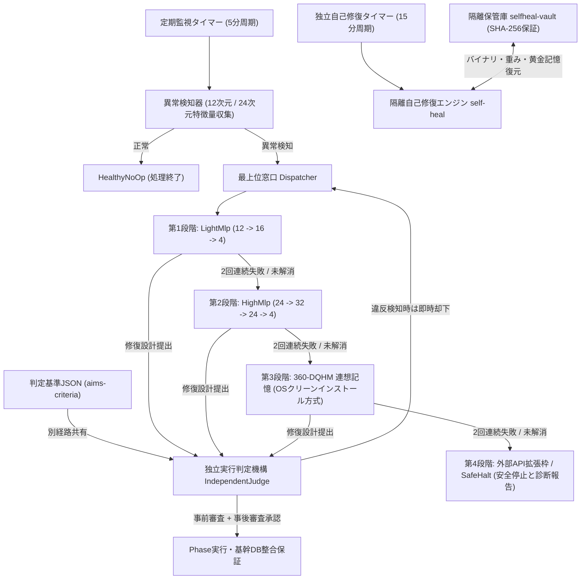

# AI自律保守システム 公開技術仕様書（AIMS-SPEC-002 / v0.2）

- 仕様識別子：`AIMS-SPEC-002`（公開汎用化版）
- 対象システム：ミッションクリティカルWebアプリケーションおよび基幹SQLiteデータベース搭載システム
- 開発・著作権：NEXSPACE

---

## 1. 設計思想と目的

長期運用環境（専任開発者の不在・保守引継ぎ後・オフライン／閉域環境を含む）において、外部 LLM API のモデル廃止、API キー失効、従量課金、外部ネットワーク障害に一切依存することなく、アプリケーションと基幹データベースの異常を自動検知し、軽量な内蔵 AI の段階昇格によって原因に応じた修復を設計・実行し、独立した実行判定機構が安全性を審査する完全自律保守システムを実現する。

- **Pure Rust `std` 構成（外部クレート依存ゼロ・外部 API 依存ゼロ）**：エンジン本体（`aims-engine`）は Rust 標準ライブラリのみを用いた単一バイナリとして構築されており、サプライチェーンリスクおよびランニング API コストを完全に排除している。
- **「業務ロジック・データ非破壊」の機械的保証**：自律修復プロセスが業務ロジック、認証機構、DB スキーマ、既存テスト、および顧客・業務データを書き換えることを、独立した判定器による機械的不変条件で禁止している。
- **到達目標と安全限界の明確化**：既知および定型障害・構造破損からの無人自律復旧を追求しつつ、未知の仕様欠陥や物理ストレージ障害など安全限界を超過した場合は無理な修復を行わず、基幹データベースを保護したまま安全停止（Safe Halt）し診断レポートを生成する。

---

## 2. 全体アーキテクチャ図（三権分立 ＋ 段階昇格 ＋ 隔離自己修復）



---

## 3. システム構成要素（役割分離アーキテクチャ）

| 構成要素 | 役割 |
| :--- | :--- |
| **不具合検知・観測機構** | ヘルスチェック（`/api/health`）、エラーログディレクトリ（`ERROR_LOG_DIR`）、SQLite 状態（`operations.db` / `-wal`）、実行時ビルド構造・静的アセット整合性を観測し、12次元および24次元の特徴量ベクトルを生成する。 |
| **最上位窓口（Dispatcher）** | 異常検知時に依頼を受領し、判定基準 JSON の完了基準と保護規則を `IndependentJudge` へ別経路で渡した上で、第1段階へ初期委任し、段階昇格と日次サーキットブレーカー（最大6回/日）を制御する。 |
| **第1段階：`LightMlp`** | 12次元特徴量から `12 -> 16 -> 4` の超軽量推論を行い、WAL 肥大・期限切れエラーログ滞留・孤立一時ファイル等の軽微な異常を分類し、無停止の軽量修復を行う。 |
| **第2段階：`HighMlp`** | 第1段階で未解消時に昇格。24次元時系列・複合特徴量から `24 -> 32 -> 24 -> 4`（LayerNorm ＋ GELU 近似活性化）の多層推論を行い、複合障害に対する中規模修復を行う。 |
| **第3段階：360-DQHM 連想記憶** | 第2段階で未解消時に昇格。正常稼働時の黄金構造を 360 次元単位複素位相ベクトルとして保持し、現在状態との位相共鳴類似度（`O(1)`）で破損層を特定した上、基幹データベースを保護したまま黄金構造アーカイブからクリーン再構築（OS クリーンインストール方式）を実行する。 |
| **第4段階：外部拡張枠 / 安全停止** | 第3段階でも未解消の場合、プラグイン拡張トレイト経由の任意修復または非 LLM 標準動作としての安全停止（`SafeHaltWithReport`）を実行し、基幹データベースと黄金状態を保護して診断レポートを出力する。 |
| **独立判定機構（`IndependentJudge`）** | 修復設計・実行主体から完全に分離された審査機構。事前審査（Pre-execution Gate）と Phase ごとの事後審査（Post-phase Gate）を機械的不変条件のみで厳格に判定する。 |
| **隔離自己修復機構（`selfheal-vault`）** | 業務保守タイマー（5分周期）とは独立した15分周期タイマーから、`aims-engine` 自身のバイナリ・重み・判定基準・黄金記憶の破損を SHA-256 検証し、破損時は隔離 Vault から無条件で原状復帰させる。 |

---

## 4. 処理フローと安全審査不変条件（Pre / Post Gate）

1. **異常検知**：5分周期タイマーまたは手動実行で特徴量を収集し、しきい値内であれば即座に `HealthyNoOp` で終了する。
2. **設計提出と事前審査（Pre-execution Gate）**：各段階 AI が修復設計（対象操作と対象パス）を `IndependentJudge` へ提出する。`forbiddenOperations`、保護対象パス（`protectedPaths`）変更、および当該段階の許可アクション外操作が含まれる場合は即座に拒否する。
3. **実行と事後審査（Post-phase Gate）**：承認された操作の実行後、以下を機械的に検証する。
   - SQLite の `PRAGMA integrity_check;` が `"ok"` であること。
   - SQLite の `PRAGMA foreign_key_check;` 違反が `0` 件であること。
   - 基準 JSON で指定された主要業務テーブル（`preserveRowCountTables`）のレコード件数が処置前を下回らないこと。
   - 保護対象ファイルの SHA-256 ハッシュが黄金記録と完全一致すること。
   - ヘルスチェックエンドポイントが HTTP 200 を返し、検知された異常指標が解消していること。
4. **段階昇格とサーキットブレーカー**：各段階の最大試行回数は **2回** とし、未解消または審査不合格が 2 回続くと次段階へ昇格する。1日の修復実行回数が上限（`maxRunsPerDay: 6`）に達した場合はサーキットブレーカーにより過負荷ループを遮断する。

---

## 5. 各段階の推論モデルと修復アクション

### 5.1 第1段階：軽量 MLP（`12 -> 16 -> 4`）
- **入力特徴量（12次元）**：ヘルス異常フラグ、直近エラー総数、500系エラー比率、DBエラー比率、WALサイズ比、期限切れログ件数、孤立一時ファイル数、メモリ負荷率、ディスク負荷率、必須パス欠損数、DB整合フラグ、再起動連続フラグ／DQHM類似度偏差。
- **出力クラス（4分類）**：
  0. `NoOp`（経過観察）
  1. `FlushWalCheckpoint`（SQLite `PRAGMA wal_checkpoint(TRUNCATE)` 実行）
  2. `CleanExpiredLogsAndTemp`（保持期限超過エラーログおよび孤立一時ファイルの整理）
  3. `LightCombinedCleanup`（上記 1・2 の複合軽量処置）

### 5.2 第2段階：高性能 MLP（`24 -> 32 -> 24 -> 4`）
- **入力特徴量（24次元）**：第1段階の12次元に加え、領域別エラー分布、前回ウィンドウとのエラー増減勾配、WAL増加率、standalone 静的アセット欠損指数、保護対象不整合件数、連続再起動回数、第1段階失敗フラグを含む24次元ベクトル。LayerNorm と GELU 近似活性化で安定分類する。
- **出力クラス（4分類）**：
  0. `RestartAppService`（事前 DB 整合確認付きアプリケーションサービス安全再起動）
  1. `DatabaseOptimizeAndBackup`（`VACUUM INTO` 整合スナップショット作成後の `PRAGMA optimize`）
  2. `SyncStandaloneAssets`（静的配信アセット欠損の再同期）
  3. `ServiceAndProxyRecovery`（上記修復群とリバースプロキシ安全リロードの段階実行）

### 5.3 第3段階：360-DQHM 連想記憶（構造クリーン再構築）
- **記憶表現**：アプリケーション構成要素（実行コード、フレームワーク設定、マイグレーション定義、静的アセット、ビルド成果物、設定テンプレート等）の正常時構造を 360 次元単位複素位相ベクトル $\theta \in [0, 2\pi)^{360}$ として順列束縛・重畳し、黄金構造記憶（`golden-dqhm.json`）へ保存する。
- **不変原則**：
  - **想起（Recall）による記憶書き換えの厳禁**：照合処理は読み取り専用とし、黄金記憶を破壊しない。
  - **記録の3層分離と追記型（Append-only）**：
    - `episodes.jsonl`（観測された障害状態と結果の経験記録）
    - `actions.jsonl`（実行された修復設計・審査結果の活動記録）
    - `revisions.jsonl`（モデル重み・基準の改訂記録）
- **位相共鳴照合と修復動作（OS クリーンインストール方式）**：
  1. 現在のシステム状態ベクトルと記憶済み黄金構造ベクトルを位相共鳴類似度 `S = (1/360) * sum(cos(theta_gold - theta_cur))` により `O(1)` で比較し、モジュール寄与度から逸脱・破損層を特定する。
  2. 基幹データベースは処置前に整合検査を行い、正常であれば安全な一時領域へ退避保護する（物理破損が確認された場合のみ、事前の整合検証済みバックアップから復元する）。
  3. アプリケーション本体・実行アセット一式を黄金構造アーカイブ（`golden-app.tar.gz`）から新規クリーン展開し、保護した基幹データベースを戻した上でサービスを再起動する。

---

## 6. CLI インタフェースおよびシステム汎用化設計

`aims-engine` は特定の業務テーブル名や URL をハードコードに依存せず、外部パラメータおよび判定基準 JSON によって任意のシステムへ適用可能である。

```bash
aims-engine <init-golden|check-and-heal|self-heal|status> \
  --app-root DIR \
  --data-dir DIR \
  --db-path FILE \
  --error-log-dir DIR \
  --aims-dir DIR \
  --criteria FILE \
  --health-url URL \
  --health-host HOST \
  --service-name UNIT
```
